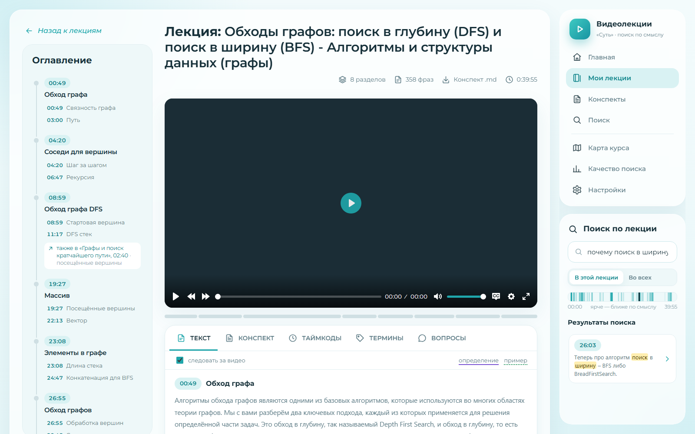
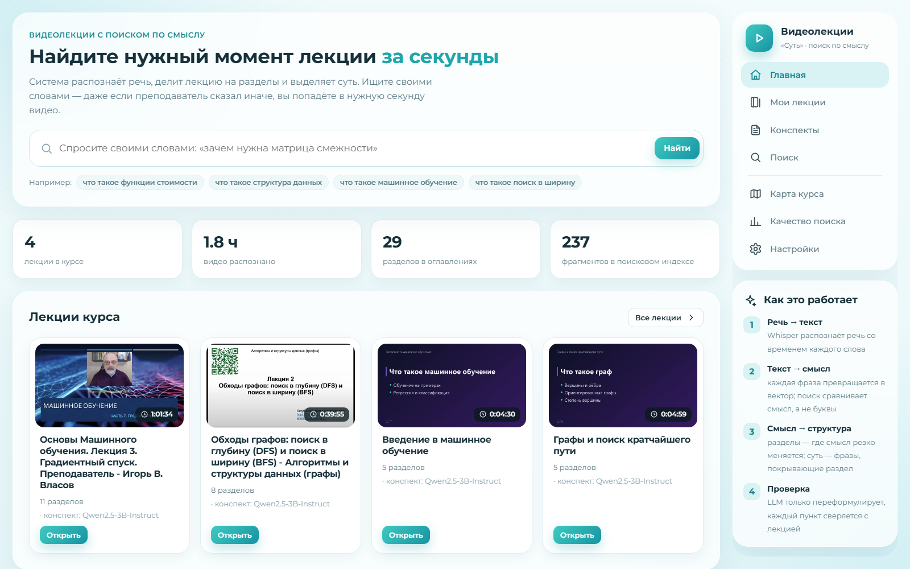
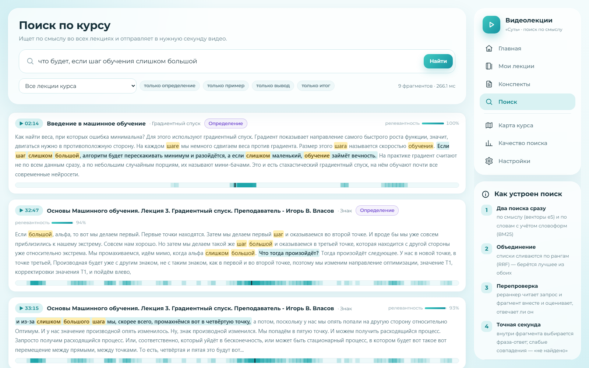
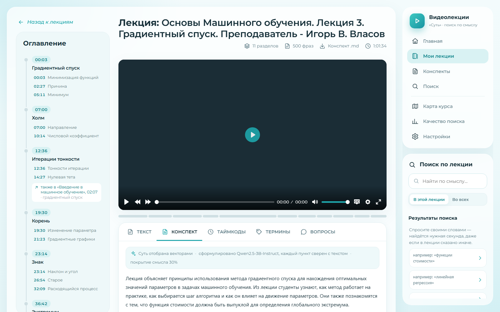
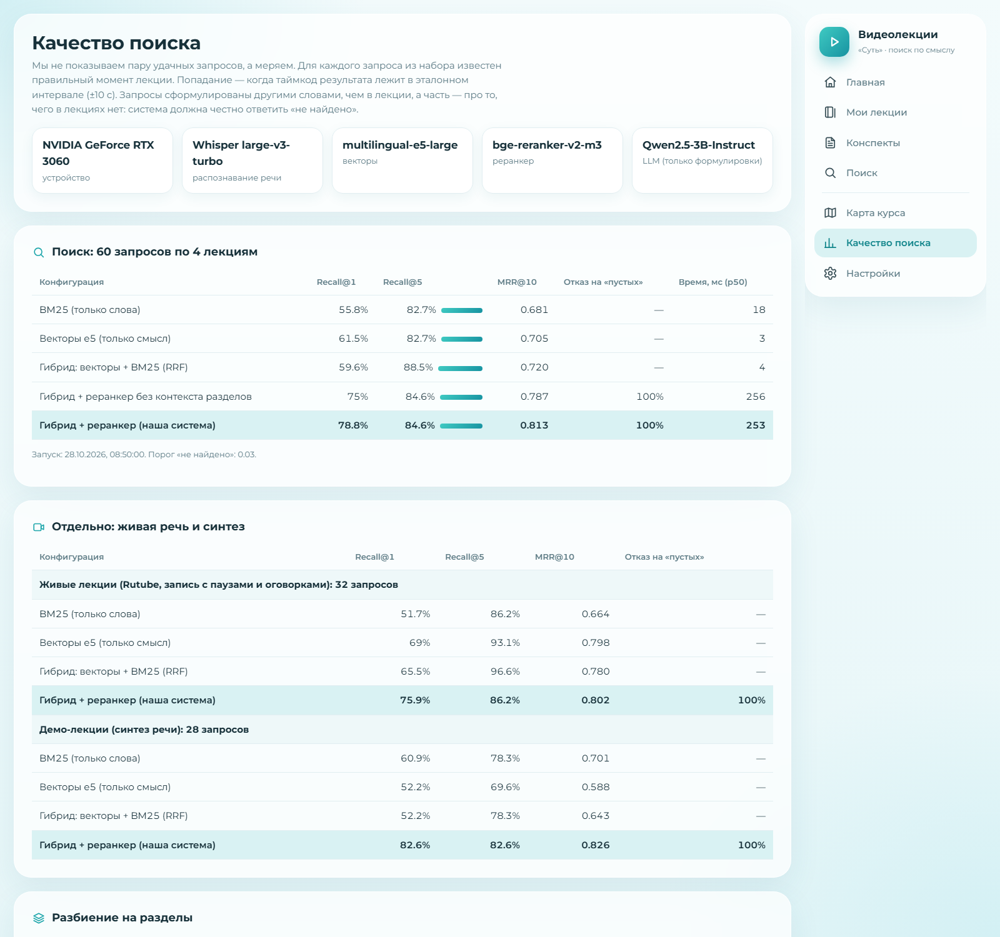

<div align="center">

# Суть

### Семантический поиск по видеолекциям

**Спросите своими словами — попадёте в нужную секунду видео,<br>даже если преподаватель сказал это иначе.**


[Что умеет](#что-умеет) · [Как это работает](#как-это-работает) · [Запуск](#запуск) · [Качество](#демо-данные-и-оценка-качества) · [Структура](#структура) · [API](#api)

<sub>Кейс хакатона «Киберрывок 2026», основной этап</sub>

</div>

<br>



Загружаете видеолекцию (файл или ссылку на Rutube/VK Видео/YouTube) — система распознаёт речь, строит смысловой индекс,
делит лекцию на разделы, выделяет суть, конспект и термины. Ищете своими словами — попадаете в нужную секунду видео.

<table>
<tr>
<td align="center"><b>79%</b><br><sub>нужный момент — первым результатом</sub></td>
<td align="center"><b>8 из 8</b><br><sub>честный отказ, если ответа в лекциях нет</sub></td>
<td align="center"><b>0,25 с</b><br><sub>время ответа поиска</sub></td>
<td align="center"><b>1,1%</b><br><sub>ошибка распознавания речи</sub></td>
<td align="center"><b>×30</b><br><sub>быстрее реального времени</sub></td>
</tr>
</table>

<sub>60 запросов своими словами по 4 лекциям (две живые с Rutube и две демо), подробности и оговорки — в разделе
[«Оценка качества»](#демо-данные-и-оценка-качества).</sub>

<table>
<tr>
<td width="50%"><p align="center"><sub>Главная: поиск по всему курсу</sub></p></td>
<td width="50%"><p align="center"><sub>Поиск: момент видео, раздел, тип фрагмента</sub></p></td>
</tr>
<tr>
<td width="50%"><p align="center"><sub>Конспект: суть каждого раздела со ссылками на видео</sub></p></td>
<td width="50%"><p align="center"><sub>Качество: метрики поиска прямо в интерфейсе</sub></p></td>
</tr>
</table>

## Что умеет

| Требование ТЗ | Как сделано |
|---|---|
| 01. Загрузка MP4/WebM и ссылок | файл (перетаскиванием) или ссылка; yt-dlp для YouTube/Vimeo/RuTube; MKV/MOV/AVI и аудио тоже принимаются — при необходимости перекодируются в MP4 (на NVIDIA через NVENC); уникальный id; звук извлекается ffmpeg |
| 02. Транскрибация и индекс | faster-whisper large-v3-turbo на GPU со временем каждого слова, фильтр галлюцинаций; векторы `multilingual-e5-large` для каждой фразы и каждого 45-секундного фрагмента; таймкоды с точностью до долей секунды |
| 03. Семантический поиск | гибрид: векторы + BM25 по леммам → слияние RRF → cross-encoder `bge-reranker-v2-m3` (его порядок сливается с порядком гибрида) → точный таймкод нужной фразы → склейка дублей → порог «не найдено». Список: текст с подсветкой, таймкод, ссылка на момент |
| 04. Плеер с навигацией | Plyr, субтитры WebVTT из слов, текст лекции подсвечивается синхронно с видео, клик по фразе перематывает |
| 05. Конспект и структура | разделы и подразделы — по векторам (TextTiling на эмбеддингах); суть раздела — задача покрытия на векторах; LLM только формулирует, каждый пункт проверяется по тексту; оглавление с переходами; экспорт в Markdown |
| Доп.: поиск по курсу | один индекс на все лекции, фильтр по лекции и по типу фрагмента |
| Доп.: вопрос-ответ | RAG: наш поиск → LLM отвечает только по найденным фрагментам со ссылками [n] на моменты видео; честный отказ, если ответа нет; кэш похожих вопросов |
| Доп.: ключевые термины | именные группы + частота × редкость в других лекциях × близость к смыслу лекции; глоссарий с моментом определения и всеми упоминаниями |
| Доп.: импорт по ссылке | yt-dlp (Rutube, VK Видео, YouTube и др.); проверено на реальных лекциях с Rutube |
| Доп.: без интернета | все модели локально в `models/`, `OFFLINE=1`; LLM можно запустить прямо в процессе |
| Интерфейс | по макету команды: оглавление-таймлайн слева от видео, вкладки «Текст / Конспект / Таймкоды / Термины / Вопросы», поиск по лекции справа под навигацией; страницы «Главная», «Мои лекции», «Конспекты», «Поиск», «Карта курса», «Качество», «Настройки»; роли «студент» и «преподаватель», светлая и тёмная тема, «продолжить просмотр», копирование глав в формате описания YouTube/Rutube, работает на телефоне |
| Сверх ТЗ | тепловая полоса «где в лекции говорится о запросе», связи между лекциями («эта тема также в лекции 5 на 23:10»), тип фрагмента (определение/пример/вывод/итог/организационное) и фильтр по нему, карта курса, страница с метриками качества |

## Как это работает

```
видео ─► звук ─► Whisper ─► слова с таймкодами ─► предложения ─► фрагменты ~45 с (перекрытие 50%)
                                                      │                 │
                                                      ▼                 ▼
                                               векторы фраз      векторы фрагментов + BM25
                                                      │                 │
                         ┌────────────────────────────┤                 ▼
                         ▼                            ▼          ПОИСК: векторы ⊕ BM25 → RRF → реранкер
                   РАЗДЕЛЫ: провалы             СУТЬ: задача покрытия           → таймкод фразы → порог
                   похожести соседних окон      (facility location)
                         │                            │
                         └──────────► LLM (только формулировки) ◄── проверка каждого пункта векторами
```

**Что предобучено, а что наше.** Готовые веса — только там, где за два дня своё не обучить: Whisper (речь → текст),
e5 (текст → вектор), bge-reranker (оценка пары «запрос–фрагмент») и LLM (формулировки). Всё, что решает задачу, — наши алгоритмы:
нарезка, BM25, слияние, точный таймкод, склейка дублей, порог отказа, сегментация на разделы, выбор сути, проверка конспекта
на выдумки, термины, связи между лекциями, тип фрагмента, тепловая полоса, оценка качества.

**Почему не «транскрипт целиком в LLM».** Каждый запрос пришлось бы отправлять вместе со всем транскриптом курса
(сотни тысяч токенов): медленно, дорого, не влезает в контекст, а таймкод модель «пишет», а не берёт из распознавания.
Наш поиск отвечает за доли секунды, работает офлайн и находит момент с точностью до фразы. Это сравнение есть в оценке
(`python -m backend.eval --llm`).

**Суть по векторам.** Брать фразы, ближайшие к среднему вектору раздела, нельзя: если в разделе две подтемы, среднее
лежит между ними. Мы решаем задачу покрытия: выбрать несколько настоящих фраз так, чтобы каждая фраза раздела была
похожа хотя бы на одну выбранную (как k-medoids). Жадный алгоритм гарантирует не хуже 63% от оптимума, а доля покрытия —
понятная метрика «выбранные фразы представляют N% смысла раздела».

**LLM не может испортить конспект.** Векторы выбирают фразы-суть, LLM по одному разделу переписывает каждую фразу
один к одному и предлагает название. Каждый пересказ сверяется со своей исходной фразой: по векторам (похожесть ≥ 0.86),
по отрицаниям (векторы не отличают «с отрицательными весами» от «с неотрицательными») и по числам. Не прошёл — в конспекте
остаётся сама фраза лекции. Название раздела LLM составляет из его ключевых фраз и принимается, только если его слова
действительно звучат в этом разделе (иначе — лучшая ключевая фраза). В конспект не попадают обрывки речи
(«Если мы посмотрим на.»), указания на слайд («вот здесь у меня показано») и связки («давайте рассмотрим подробнее»).
Наведите на пункт конспекта — увидите исходную фразу.

**Связи между лекциями и карта курса.** Средние векторы разделов у e5 почти одинаковы (≈0.95 у любой пары), поэтому
разделы сравниваются выравниванием фраз: для каждой фразы — самая похожая фраза другого раздела, усреднение лучших
совпадений. Сравниваются только содержательные фразы: «что мы делаем дальше?» звучит в любой лекции. Связь показывается,
только если пара взаимно лучшая, заметно выделяется на фоне остальных и у разделов есть общий ключевой термин;
ссылка ведёт на конкретную совпавшую фразу. Карта курса строится по тем же расстояниям (MDS), группы тем — иерархическая
кластеризация с выбором числа групп по силуэту.

## Запуск

Нужны Python 3.10+ и ffmpeg в PATH. Видеокарта NVIDIA желательна (на CPU всё работает, но распознавание медленнее).

```bat
run.bat
```

Первый запуск создаёт `.venv` и ставит зависимости, затем открывает http://127.0.0.1:8000.
Вручную:

```bash
python -m venv .venv
.venv\Scripts\python -m pip install -r requirements.txt
.venv\Scripts\python -m tools.download_models --local-llm   # модели в models/ (можно пропустить — скачаются сами)
.venv\Scripts\python -m backend
```

Настройки — в `.env` (пример в `.env.example`):

- **LLM-сервер** (лучше качество формулировок): Ollama — `ollama pull qwen2.5:7b`, по умолчанию уже настроено;
  DeepSeek — `LLM_BASE_URL=https://api.deepseek.com/v1`, `LLM_MODEL=deepseek-chat`, `LLM_API_KEY=...`.
- **Без сервера**: если LLM-сервер недоступен, используется локальная `Qwen2.5-3B-Instruct` прямо в процессе;
  если нет и её — конспект собирается из фраз-сути (по векторам), чат показывает найденные фрагменты.
- **Без интернета**: `OFFLINE=1` после `tools.download_models`.
- **Без GPU**: `DEVICE=cpu ASR_MODEL=small EMBED_MODEL=intfloat/multilingual-e5-small RERANK_MODEL=`.
- **huggingface.co недоступен**: `HF_ENDPOINT=https://hf-mirror.com`.

## Демо-данные и оценка качества

```bash
python -m tools.make_demo_lectures   # две демо-лекции (синтез речи + слайды) и эталон: время каждого абзаца
python -m backend.eval               # метрики → data/eval/results.json и страница «Качество»
python -m backend.eval --llm         # + базовая линия «весь транскрипт в LLM»
python -m pytest -q                  # тесты алгоритмов
```

Эталон для реальных лекций — `eval/real_lectures.json` (ссылки на видео внутри; загрузите их через «Мои лекции»
и запустите оценку — запросы к лекциям, которых нет в индексе, пропускаются сами). Свои лекции: добавьте запросы
с интервалами в этот файл или в `data/eval/queries.json` (формат описан в `backend/eval.py`).

### Результаты (RTX 3060, 4 лекции в одном индексе)

60 запросов: 52 с эталонным моментом, сформулированных своими словами, а не цитатами, и 8 «пустых» — о том,
чего в лекциях нет. Попадание — таймкод внутри эталонного интервала ±10 с. Поиск идёт по всему курсу сразу,
то есть демо-лекции мешают живым и наоборот.

| Конфигурация | Живые лекции R@1 | R@5 | MRR | Демо R@1 | R@5 | MRR | Отказ на «пустых» |
|---|---|---|---|---|---|---|---|
| BM25 (только слова) | 0.517 | 0.862 | 0.664 | 0.609 | 0.783 | 0.701 | — |
| Векторы e5 (только смысл) | 0.690 | 0.931 | 0.798 | 0.522 | 0.696 | 0.588 | — |
| Гибрид: векторы + BM25 (RRF) | 0.655 | **0.966** | 0.780 | 0.522 | 0.783 | 0.643 | — |
| **Гибрид + реранкер (система)** | **0.759** | 0.862 | **0.802** | **0.826** | **0.826** | **0.826** | **100%** (8 из 8) |

- **Живые лекции** — две записи с Rutube: «Обходы графов: DFS и BFS» (40 мин) и «Градиентный спуск» (61 мин),
  32 запроса (29 с ответом, 3 «пустых»). **Демо** — две синтезированные лекции, 28 запросов.
- Время ответа поиска ≈ 0.25 с (p50 по курсу из 4 лекций; реранкер проверяет 30 кандидатов на каждый запрос).
- Распознавание: WER **1.1%** на выверенном фрагменте; живая 40-минутная лекция распознаётся за 79 с (в 30 раз быстрее
  реального времени), часовая — за 84 с. Ссылка → можно искать: ~2.5 мин для 40-минутной лекции.
- Разделы: Pk 0.10 и 0.37 на демо-лекциях (меньше — лучше; случайное разбиение ≈ 0.5).
- Базовая линия «весь транскрипт в LLM» на демо-лекциях (Qwen2.5-3B): R@1 0.043, R@5 0.087, 5.3 с на запрос.

Честные оговорки: эталон размечали мы сами по транскриптам; после первого прогона в шесть запросов добавлены
места, где лектор повторяет ту же мысль или она есть в другой лекции, — это видно по полю `about` в эталоне.
Порог «не найдено» (0.03) и вес слияния порядков (0.5) подобраны на этом же наборе: «пустые» запросы набирают до 0.02, верные ответы почти всегда
выше 0.07. Реранкер поднимает R@1, но на живых лекциях немного снижает R@5 относительно гибрида — он уверенно
выбирает один ответ. Базовая линия с LLM посчитана на маленькой локальной модели: с крупной (DeepSeek, GPT)
точность выше, но запрос остаётся на порядки медленнее и не масштабируется на курс из десятков лекций.

### Как найдены и исправлены проблемы (по цифрам)

- Пакетный режим faster-whisper без временных меток терял хвосты окон (пропадал целый абзац) —
  с `without_timestamps=False` WER упал с 4.6% до 1.1%.
- Затравка Whisper без знаков препинания отучала модель ставить точки — фраз было в 3 раза меньше, чем нужно.
- Таймкод внутри фрагмента выбирает реранкер по отдельным фразам: +2 попадания в R@1.
- Живая речь: связи между лекциями цеплялись за переходные фразы («Что мы делаем дальше?» ↔ «Что тогда произойдёт?»)
  и связывали обход графа с градиентным спуском. Теперь сравниваются только содержательные фразы и нужен общий
  ключевой термин — осталась связь «Обходы графов ↔ Поиск в ширину» и «Градиентный спуск ↔ Градиентный спуск».
- Живая речь: в конспект попадали обрывки («Если мы посмотрим на.») и указания на слайд — добавлены фильтры.
- Живая речь: локальная LLM 3B склеивала названия разделов («ОбходГрафа», «Регрессия цена», «Поиск вширину») —
  название принимается, только если его слова звучат в разделе и оно грамматически согласовано (pymorphy);
  иначе — ключевая фраза раздела.
- Реранкер иногда опускал верный фрагмент, который гибрид держал высоко: итоговый порядок — слияние порядков
  реранкера и гибрида (вес 0.5), R@1 на живых лекциях 0.724 → 0.759, на демо 0.783 → 0.826.
- Порог «не найдено» 0.01, подобранный на синтетике, пропускал «как работает протокол TCP» на живых лекциях
  (0.017) — порог 0.03.
- YouTube отдаёт видео только после входа в аккаунт («подтвердите, что вы не бот») — понятное сообщение
  и совет загрузить файл или дать ссылку Rutube/VK.

## Структура

```
backend/
  app.py            HTTP API, раздача видео с Range (перемотка), фронтенд
  pipeline.py       обработка лекции по этапам с прогрессом
  jobs.py           очередь обработки (по одной лекции, продолжение после перезапуска)
  media.py          ffmpeg / yt-dlp: проверка формата, перекодирование, звук, превью
  eval.py           оценка качества
  ml/
    asr.py          Whisper + фильтр галлюцинаций
    text.py         предложения из слов, леммы, субтитры
    chunking.py     фрагменты с перекрытием
    models.py       кодировщик и реранкер (загрузка по требованию, fp16)
    bm25.py         свой BM25 на разреженных матрицах
    index.py        общий индекс курса в памяти
    search.py       гибридный поиск, RRF, реранкер, таймкод, склейка, порог, тепловая полоса
    segmentation.py разделы и подразделы по векторам
    essence.py      суть: задача покрытия
    summarize.py    конспект: векторы выбирают, LLM формулирует, векторы проверяют
    terms.py        термины и глоссарий
    fragtypes.py    тип фрагмента по эталонным фразам
    course.py       связи между лекциями, карта курса
    llm.py          OpenAI-совместимый сервер / локальная модель / без LLM
    qa.py           вопрос-ответ со ссылками на моменты
frontend/           без сборки: ES-модули + Plyr, шрифт Montserrat лежит локально (работает без интернета)
  js/views/         home (главная), library (мои лекции), lecture (лекция), notes (конспекты), search,
                    map (карта курса), quality (метрики), settings
eval/real_lectures.json  эталон для реальных лекций с Rutube (запросы своими словами + интервалы)
tools/              демо-лекции, скачивание моделей
```

## API

| Метод | Путь | Что делает |
|---|---|---|
| GET | `/api/lectures` | список лекций со статусом обработки |
| POST | `/api/lectures` | загрузить файл (multipart: `file`, `title`) |
| POST | `/api/lectures/url` | добавить по ссылке `{url, title}` |
| GET | `/api/lectures/{id}` | лекция: разделы, конспект, термины |
| GET | `/api/lectures/{id}/transcript` | фразы с таймкодами и типами |
| GET | `/api/lectures/{id}/video` | видео с поддержкой Range |
| GET | `/api/lectures/{id}/subtitles.vtt` | субтитры |
| GET | `/api/lectures/{id}/heat?q=` | тепловая полоса по запросу |
| GET | `/api/lectures/{id}/links` | похожие разделы в других лекциях |
| GET | `/api/lectures/{id}/export.md` | конспект в Markdown |
| POST | `/api/lectures/{id}/reprocess` | пересобрать с этапа (`structure` — переписать конспект) |
| GET | `/api/search?q=&lecture=&types=` | семантический поиск |
| POST | `/api/ask` | вопрос-ответ `{question, lecture_id, history}` |
| GET | `/api/map` | карта курса |
| GET | `/api/status`, `/api/eval` | состояние системы, метрики |
